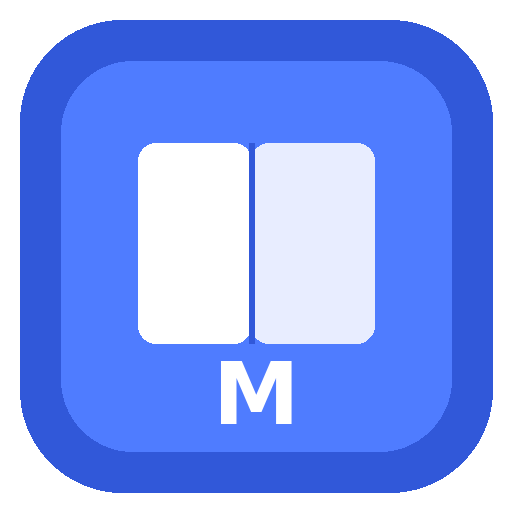
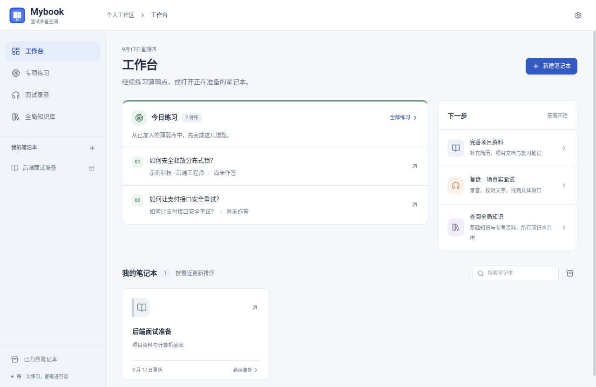
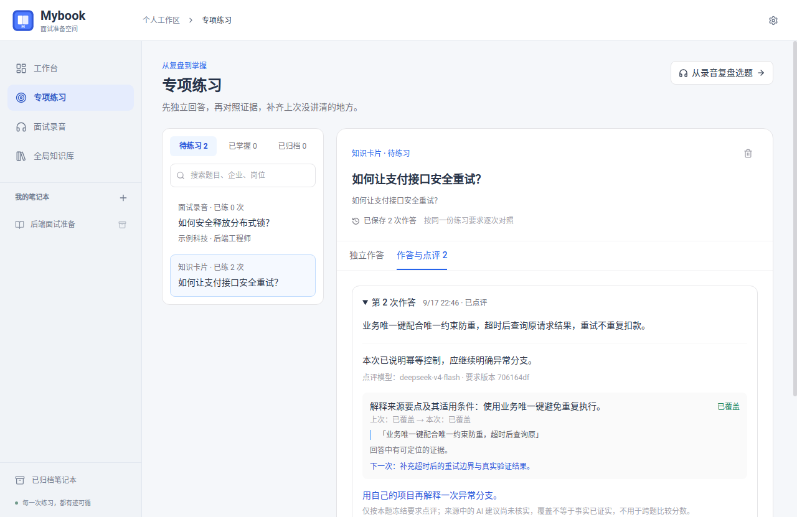
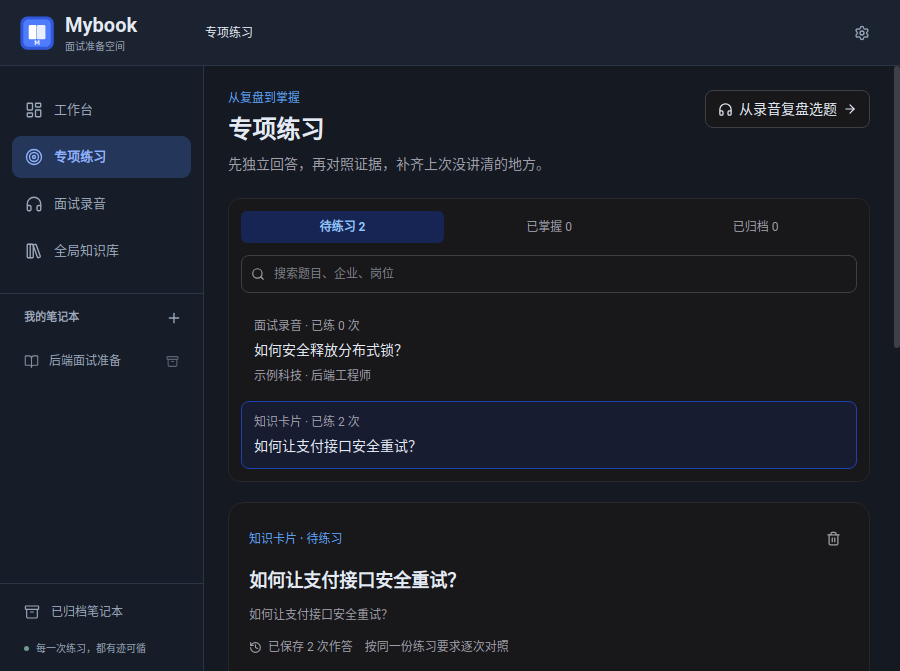
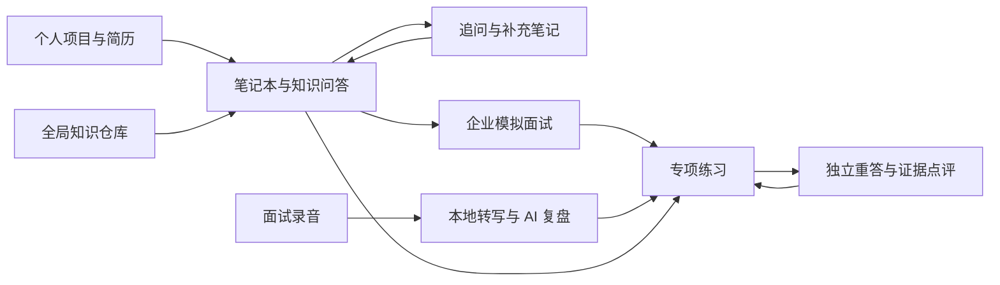

<div align="center">
  
  <h1>Mybook</h1>
  <p><strong>把项目资料、每一次追问和每一场面试，变成下一次答得更好的准备。</strong></p>
  <p>本地优先的 AI 面试准备桌面应用</p>
  <p>
    
    
    
    
  </p>
</div>

Mybook 面向准备技术面试的开发者。它将个人项目资料、计算机基础知识、企业岗位要求和面试复盘放在同一个工作空间，让复习从“收藏答案”延伸到“独立作答、发现缺口、再次练习”。

产品形态借鉴 NotebookLM 的资料驱动问答，进一步围绕面试准备建立持续积累的知识库：追问的回答会自动保存并参与后续检索；模拟面试和录音复盘中的题目，可以进入专项练习，保留每次回答与点评。

## 界面预览

### 工作台

今日待练、下一步动作与项目笔记本集中展示，打开应用就能继续准备。



### 专项练习

先独立回答，再查看参考；按同一份练习要求对照历次回答，并定位本轮答案中的证据。



<details>
  <summary>查看暗色与窄屏界面</summary>



</details>

截图使用隔离的演示资料；截图中的 AI 点评为测试响应，不代表真实模型评测结果。

## 核心功能

| 功能 | 能帮助你做什么 |
| --- | --- |
| 项目笔记本 | 导入 PDF、Word、Markdown、文本或网页，把简历和项目文档组织成复习资料。笔记本可以归档和恢复。 |
| 资料驱动问答 | 围绕已有资料提问、追问；回答自动进入补充知识库，并导出 Markdown，后续问答可以再次检索。 |
| AI 知识卡片 | 生成面试问答、学习指南、关键概念和项目亮点，支持搜索、折叠、删除与引用查看。 |
| 全局知识仓库 | 在应用中添加、同步、启停资料仓库，所有笔记本共享访问；通过配置包管理来源。 |
| 企业模拟面试 | 填写公司、部门、岗位、JD 和标签，结合个人资料与公开面经逐题问答，保存点评、参考答案及复习知识。 |
| 可复用目标岗位 | 保存企业与岗位信息，在后续模拟面试和录音中复用；历史面试保留当时的岗位信息。 |
| 录音与本地转写 | Linux 下采集麦克风和系统输出，也可以导入音频；本地转写后校对文字、说话人并回听。 |
| AI 面试复盘 | 从转写中整理问题、实际回答、缺陷、参考答案与追问建议；录音文档可参与全局知识检索。 |
| 专项练习 | 从卡片、模拟面试或录音复盘选题，独立重答、逐项点评、保留历史，标记掌握或暂时归档。 |
| 多模型降级 | 读取已配置的模型目录，优先使用选定模型，失败后尝试其他模型和服务；校验结构化结果及来源编号。 |

### 让复习形成闭环



专项练习会保留选题时的原答案、参考资料、岗位上下文与练习要求。后续修改或删除原资料，不会改写已有练习历史。点评按同一份要求检查“已覆盖 / 待补充 / 未体现”，不把不同题目的总分简单拼成成长曲线。

## 开始使用

1. **创建笔记本**：按目标岗位或项目组织资料，导入自己的简历、项目说明和学习文档。
2. **接入模型**：在 [CC Switch](https://github.com/farion1231/cc-switch) 中配置服务，再在 Mybook 设置中选择并测试模型。
3. **补充通用知识**：在全局知识库中导入 [`interview-foundations.json`](repository-packs/interview-foundations.json)，按需同步小林 coding、沉默王二和 JavaGuide，也可以添加自己的仓库。
4. **带着目标练习**：填写企业、部门和 JD，开始模拟面试；或导入一次真实面试的录音，转写、校对并复盘。
5. **回到薄弱点**：点击「加入专项练习」，先独立作答，再看参考与点评，下次继续回答同一道题。

仓库配置包只包含来源地址和说明，不包含上述网站的正文。资料由使用者按需同步，原文版权与许可归各自作者。

## 数据与模型

Mybook 采用 Electron + SQLite，在本机保存笔记本、知识卡片、对话、转写与练习记录。

| 数据或操作 | 处理位置 |
| --- | --- |
| 笔记本、问答、练习历史 | 本地 SQLite 数据库 |
| 录音与 Markdown 文档 | 本地文件系统 |
| 语音转文字 | 本地 faster-whisper，默认 Whisper small / CPU int8 |
| AI 问答、卡片、模拟面试和复盘 | 调用使用者配置的模型服务，发送任务需要的文本与检索资料 |
| 知识仓库同步与公开面经搜索 | 联网访问对应仓库或搜索服务 |

当前模型配置读取 `~/.cc-switch/cc-switch.db`，支持代码中已适配的 Anthropic、OpenAI Chat Completions / Responses 兼容服务。实际可用模型取决于用户的服务配置、权限和额度，源码不绑定单个模型，也不附带 API Key。

录音文档默认可在所有笔记本中检索，可以在录音详情关闭共享。戴耳机录制系统声音时，需要选择该耳机对应的输出监视器。详细步骤见 [录音与复盘说明](docs/interview-recording.md)。

## 本地开发

当前主要开发和验收平台为 Linux。建议使用 **Node.js 24 LTS**；项目声明的最低版本为 22.12。依赖以 `apps/desktop/package-lock.json` 为准。

```bash
git clone https://github.com/xianyu-sheng/mybook.git
cd mybook/apps/desktop

npm ci

# 将 SQLite 原生模块编译为 Electron 对应的版本
npx electron-rebuild -f -w better-sqlite3

npm run dev
```

原生依赖若需要本地编译，请准备 Python 3、C/C++ 编译器和 make。Ubuntu / Debian 可以安装：

```bash
sudo apt install build-essential python3 python3-venv ffmpeg pulseaudio-utils
```

音频捕获依赖 FFmpeg、`pactl` 和正在运行的 PipeWire/PulseAudio。首次本地转写需在应用中安装引擎并下载模型；`uv` 可加速安装，没有 `uv` 时程序尝试 Python venv/pip。

### 检查与构建

在 `apps/desktop` 目录中运行：

```bash
npm run typecheck
npx vitest run
npm run build
```

Linux 打包：

```bash
npm run package
```

产物位于 `apps/desktop/release/`。若 Electron 下载缓存不可用，但 `node_modules/electron/dist` 已完整存在，可以复用本地运行时：

```bash
npm run build
npx electron-builder --linux AppImage deb --config.electronDist=node_modules/electron/dist
```

数据库与用户资料不随代码发布。首次开发启动会创建本地资料目录；应用升级保留旧品牌的兼容路径及内部 `knowmind:*` IPC 名称，因此代码目录中仍可见 `knowmind`。

## 项目结构

```text
mybook/
├── apps/desktop/
│   ├── electron/
│   │   ├── ai/             # 模型路由、检索、卡片与结构校验
│   │   ├── db/             # SQLite 与版本迁移
│   │   ├── ipc/            # 桌面接口
│   │   ├── interview/      # 面试上下文与公开面经
│   │   ├── practice/       # 独立重答、要求快照与点评历史
│   │   ├── recording/      # 录音、转写、播放与复盘
│   │   └── repository/     # 全局资料同步与全文检索
│   ├── src/                # React 页面、组件与状态管理
│   └── assets/speech/      # 本地 Python 转写入口
├── docs/                   # 使用说明与演示截图
└── repository-packs/        # 可导入的知识仓库配置
```

技术栈：Electron 33、React 19、TypeScript、Vite、Tailwind CSS、better-sqlite3 / FTS5、AI SDK、FFmpeg、faster-whisper。

## 当前状态与后续方向

当前版本为 **0.5.0**。该版本完成 179 项单元测试和 99 项安装版检查；另有 4 项历史 Electron ABI 测试跳过。覆盖迁移、引用、模型降级、答案持久化、卡片操作、录音导入、播放、本地转写及异常恢复。AI 故障与结构校验使用模拟接口验证，本地 ASR 使用公开音频实测。

以下工作仍在迭代：

- 多小时录音的分段检查点、复盘预算和断点续跑。
- 企业面经的发表日期、部门和岗位匹配。
- 更稳定的跨转写窗口题目识别，减少同一问题被重复计入。
- 大规模资料检索、同义词召回和真实模型点评一致性评估。
- 可编辑的练习要求版本、复习调度及完整备份恢复。
- Windows / macOS 适配，以及实体耳机通话和干净环境安装验收。

AI 生成的参考答案与评分需要结合原始资料核对；项目仓库归属不能直接证明个人贡献。GitHub 账号导入目前读取公开仓库目录，读取项目正文请导入具体文档或仓库 URL。

## 项目与许可

由 [xianyu-sheng](https://github.com/xianyu-sheng) 维护。目前为私有开发仓库，尚未声明开源许可证。第三方依赖、语音模型及知识资料遵循各自的许可证。
