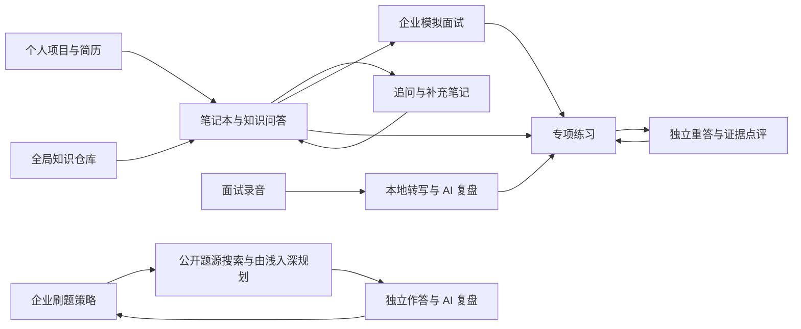

<div align="center">
  
  <h1>Mybook</h1>
  <p><strong>把项目资料、每一次追问和每一场面试，变成下一次答得更好的准备。</strong></p>
  <p>本地优先的 AI 面试准备桌面应用</p>
  <p>
    
    
    
    
  </p>
</div>

Mybook 面向准备技术面试的开发者。它将个人项目资料、计算机基础知识、企业岗位要求和面试复盘放在同一个工作空间，让复习从“收藏答案”延伸到“独立作答、发现缺口、再次练习”。

产品形态借鉴 NotebookLM 的资料驱动问答，进一步围绕面试准备建立持续积累的知识库：追问的回答会自动保存并参与后续检索；模拟面试和录音复盘中的题目，可以进入专项练习，保留每次回答与点评。

## 界面预览

### 工作台

今日待练、下一步动作与项目笔记本集中展示，打开应用就能继续准备。


### 专项练习

先独立回答，再查看参考；按同一份练习要求对照历次回答，并定位本轮答案中的证据。


<details>
  <summary>查看暗色与窄屏界面</summary>


</details>

截图使用隔离的演示资料；截图中的 AI 点评为测试响应，不代表真实模型评测结果。

## 核心功能

| 功能 | 能帮助你做什么 |
| --- | --- |
| 项目笔记本 | 导入 PDF、Word、Markdown、文本或网页，把简历和项目文档组织成复习资料。笔记本可以归档和恢复。 |
| 知识问答 | 侧栏独立入口，按会话新建、切换、重命名和删除；同时检索所有笔记本资料、全局仓库、共享面试录音和历史问答，回答带来源并自动参与后续检索。 |
| AI 知识卡片 | 生成面试问答、学习指南、关键概念和项目亮点，支持搜索、折叠、删除与引用查看。 |
| 全局知识仓库 | 在应用中添加、同步、启停资料仓库，所有笔记本共享访问；通过配置包管理来源。 |
| 企业模拟面试 | 填写公司、部门、岗位、JD 和标签，结合个人资料与公开面经逐题问答，保存点评、参考答案及复习知识。 |
| 可复用目标岗位 | 保存企业与岗位信息，在后续模拟面试和录音中复用；历史面试保留当时的岗位信息。 |
| 录音与本地转写 | Linux 和 Windows 原生采集麦克风与系统输出（包括耳机），也可以导入音频；本地转写后校对文字、说话人并回听。 |
| AI 面试复盘 | 从转写中整理问题、实际回答、缺陷、参考答案与追问建议；录音文档可参与全局知识检索。 |
| 专项练习 | 从卡片、模拟面试或录音复盘选题，独立重答、逐项点评、保留历史，标记掌握或暂时归档。 |
| 刷题计划 | 按企业、部门、岗位和 JD 创建多套隔离策略；搜索牛客、小红书、CodeTop、力扣和灵神公开题源，自动按知识基础、题型模式和难度规划顺序。 |
| 刷题作答与复盘 | 记录思路、代码、语言和复杂度，AI 结合题面评价正确性、边界、复杂度、替代解法和进阶方向；答案先落盘，模型失败可重试。 |
| 力扣 / 牛客同步 | 复用已有平台登录状态，导入力扣近期提交和牛客统计快照；同步记录与本地作答、复盘分开保存。 |
| 多模型降级 | 读取已配置的模型目录，优先使用选定模型，失败后尝试其他模型和服务；校验结构化结果及来源编号。 |

### 让复习形成闭环



专项练习会保留选题时的原答案、参考资料、岗位上下文与练习要求。后续修改或删除原资料，不会改写已有练习历史。点评按同一份要求检查“已覆盖 / 待补充 / 未体现”，不把不同题目的总分简单拼成成长曲线。

## 开始使用

1. **创建笔记本**：按目标岗位或项目组织资料，导入自己的简历、项目说明和学习文档。
2. **接入模型**：打开设置 →「AI 供应商」，填入服务商的 Base URL、API Key 和模型名并保存。支持 OpenAI 兼容服务（DeepSeek、通义、Kimi、OpenRouter、Ollama 等）和 Anthropic 协议；已装 [CC Switch](https://github.com/farion1231/cc-switch) 的用户也可以继续使用其中的配置。
3. **补充通用知识**：在全局知识库中导入 [`interview-foundations.json`](repository-packs/interview-foundations.json)，按需同步小林 coding、沉默王二和 JavaGuide，也可以添加自己的仓库。
4. **带着目标练习**：填写企业、部门和 JD，开始模拟面试；或导入一次真实面试的录音，转写、校对并复盘。
5. **回到薄弱点**：点击「加入专项练习」，先独立作答，再看参考与点评，下次继续回答同一道题。
6. **建立刷题策略**：进入「刷题计划」，填写企业、部门、岗位和 JD；策略会保留上次位置。可以同时建立“字节后端”“快手后端”等不同策略，同一题的元数据共享，但进度、作答和复盘彼此隔离。
7. **同步外部记录**：在策略中按需连接力扣或牛客并点击同步。力扣当前同步近期提交快照，牛客当前同步公开统计；两者都不会覆盖 Mybook 的本地答案和 AI 复盘。

仓库配置包只包含来源地址和说明，不包含上述网站的正文。资料由使用者按需同步，原文版权与许可归各自作者。

## 数据与模型

Mybook 采用 Electron + SQLite，在本机保存笔记本、知识卡片、对话、转写与练习记录。

| 数据或操作 | 处理位置 |
| --- | --- |
| 笔记本、问答、练习历史 | 本地 SQLite 数据库 |
| 刷题策略、题目进度、作答、复盘和平台同步快照 | 本地 SQLite 数据库；同一题的公共元数据可被多套策略复用 |
| 录音与 Markdown 文档 | 本地文件系统 |
| AI 供应商与 API Key | 本机 SQLite 的 settings 表；可在设置页增删，不写入仓库或导出文件 |
| 语音转文字 | 本地 faster-whisper，默认 Whisper small / CPU int8 |
| AI 问答、卡片、模拟面试和复盘 | 调用使用者配置的模型服务，发送任务需要的文本与检索资料 |
| 知识仓库同步与公开面经搜索 | 联网访问对应仓库或搜索服务 |

模型配置由使用者在应用内自行添加，支持 Anthropic、OpenAI Chat Completions / Responses 兼容服务。API Key 只写入本机数据库（`userData/knowmind.db`），不会进入源码、安装包或导出文件；应用也兼容本机已有的 CC Switch 配置作为可选项。实际可用模型取决于用户的服务配置、权限和额度，源码不绑定单个模型，也不附带 API Key。

录音文档默认可在所有笔记本中检索，可以在录音详情关闭共享。戴耳机录制系统声音时，需要选择该耳机对应的输出监视器；Windows 使用 WASAPI 回环，Linux 使用 PulseAudio/PipeWire monitor。详细步骤见 [录音与复盘说明](docs/interview-recording.md)。

## 下载与安装

[Releases](https://github.com/xianyu-sheng/mybook/releases) 提供每个版本的 Linux AppImage、Linux deb 和 Windows NSIS 安装器，并附 SHA256 校验文件。Windows 安装器允许选择安装目录，卸载时默认保留本地数据库、录音和转写模型。

首次使用本地转写时，应用会在用户数据目录创建 Python 虚拟环境并下载 faster-whisper 与约 500 MB 的 Whisper small 模型。录音、数据库和模型不会打包进安装器，也不会进入 Git 仓库。

## 本地开发

当前主要开发和验收平台为 Linux，发布由 GitHub Actions 同时在 Ubuntu 和 Windows runner 上构建。建议使用 **Node.js 24 LTS**；项目声明的最低版本为 22.12。依赖以 `apps/desktop/package-lock.json` 为准。

```bash
git clone https://github.com/xianyu-sheng/mybook.git
cd mybook/apps/desktop

npm ci

# 将 SQLite 原生模块编译为 Electron 对应的版本
npx electron-rebuild -f -w better-sqlite3

npm run dev
```

原生依赖若需要本地编译，请准备 Python 3、C/C++ 编译器和 make。Ubuntu / Debian 可以安装：

```bash
sudo apt install build-essential python3 python3-venv ffmpeg pulseaudio-utils
```

音频捕获依赖 FFmpeg、`pactl` 和正在运行的 PipeWire/PulseAudio。首次本地转写需在应用中安装引擎并下载模型；`uv` 可加速安装，没有 `uv` 时程序尝试 Python venv/pip。

### 检查与构建

在 `apps/desktop` 目录中运行：

```bash
npm run typecheck
npx vitest run
npm run build
```

Linux 打包：

```bash
npm run package
```

产物位于 `apps/desktop/release/`。若 Electron 下载缓存不可用，但 `node_modules/electron/dist` 已完整存在，可以复用本地运行时：

```bash
npm run build
npx electron-builder --linux AppImage deb --config.electronDist=node_modules/electron/dist
```

Windows 打包（需要 Windows 主机与 .NET 8 SDK，GitHub Actions 自动准备）：

```powershell
cd apps/desktop
npm ci
npm run package:windows
```

Windows 录音使用随应用发布的 .NET/NAudio helper：WASAPI 负责麦克风和扬声器或耳机输出；安装包包含运行时，使用者无需另装 .NET 或 FFmpeg。随包附带的 FFmpeg/FFprobe 用于导入、转换与探测音频。Linux 的 PulseAudio/PipeWire 输入需要系统 FFmpeg 和 `pactl`，安装依赖见上方命令。

数据库与用户资料不随代码发布。首次开发启动会创建本地资料目录；应用升级保留旧品牌的兼容路径及内部 `knowmind:*` IPC 名称，因此代码目录中仍可见 `knowmind`。

## 项目结构

```text
mybook/
├── apps/desktop/
│   ├── electron/
│   │   ├── ai/             # 模型路由、检索、卡片与结构校验
│   │   ├── db/             # SQLite 与版本迁移
│   │   ├── ipc/            # 桌面接口
│   │   ├── interview/      # 面试上下文与公开面经
    │   │   ├── practice/       # 独立重答、要求快照与点评历史
    │   │   ├── coding/         # 刷题策略、题源搜索、规划、作答与平台同步
│   │   ├── recording/      # 录音、转写、播放与复盘
│   │   └── repository/     # 全局资料同步与全文检索
│   ├── src/                # React 页面、组件与状态管理
│   └── assets/speech/      # 本地 Python 转写入口
├── docs/                   # 使用说明与演示截图
└── repository-packs/        # 可导入的知识仓库配置
```

技术栈：Electron 33、React 19、TypeScript、Vite、Tailwind CSS、better-sqlite3 / FTS5、AI SDK、FFmpeg、faster-whisper。

## 当前状态与后续方向

当前版本为 **0.10.0**。0.10.0 强化 AI 复盘与复习内容：面试复盘、复习卡片、刷题复盘和专项练习在涉及可实现方案时要求附最小可运行代码，追问同时给出建议回答；面试录音在落盘和展示时自动把 Whisper 的繁体输出转为简体，并按同一说话人的连续片段合并为更长的段落，转写提示也要求使用简体中文。0.9.12 把知识仓库同步改为增量：只下载新增或文件指纹发生变化的文档，已有文档不再重复拉取、也不再重建整个索引；仓库中已删除的文档会从本地移除，旧索引在版本未变化时自动补齐文件指纹。0.9.11 完善仓库同步的代理处理：全局 Git 代理失效时优先使用系统代理（例如 Clash 的 `127.0.0.1:7890`），系统代理也不可用才直连；修复部分网络下仓库目录能下载、但拉取 Markdown 正文时 checkout 仍失败的问题。0.9.10 开始检测失效的全局 Git 代理（例如 `127.0.0.1:3067`），不再让残留端口阻断同步。0.9.9 修复顶栏外观菜单被页面内容盖住、点击无响应的问题，纯色/轻透/通透现在都能正常切换；外观面板新增「重新检测」，Wallpaper Engine 换场景后无需重启应用。0.9.8 统一壁纸外观：知识问答改为透明画布加玻璃消息气泡，设置、录音、专项练习、全局知识库等页面统一使用半透明主画布和玻璃卡片；降低模糊/遮罩强度，壁纸不再被整块面板盖住或只覆盖部分页面。0.9.7 的桌面壁纸背景优先读取 Wallpaper Engine 当前壁纸（使用项目预览图，缺失时抽取 GIF/视频帧），并支持在设置中选择自定义图片；不再误用旧的系统壁纸路径。0.9.6 在顶栏增加外观快捷开关，可在纯色、轻透、通透之间即时切换，无需进入设置页。0.9.5 增加桌面壁纸外观：只读取当前桌面壁纸图片，模糊后作为窗口背景，提供「轻透 / 通透」两档并可在设置关闭；不采集桌面图标、窗口或屏幕内容。0.9.4 把知识问答从笔记本内移到侧栏独立入口，支持多会话管理，并跨全部笔记本、全局知识库、共享面试录音和历史问答检索；旧版笔记本问答会自动迁移成全局会话。0.9.3 把知识问答的输出预算从 2000 提高到 16000，并延长单次/总超时、启用流式传输，避免推理模型的长回答在中途被截断。0.9.2 修复 Windows 中文环境下本地转写输出被 GBK 编码污染的问题，并把 PyAV 固定到 15.1.0，避免 faster-whisper 因 `metadata_errors` 参数被移除而无法转写。0.9.1 让 AI 复盘支持断点续跑：每完成一个分析窗口就保存一次，模型超时或输出被截断时保留已分析好的题目，再次点击从断点继续；同时提高输出预算、自动抢救被截断的 JSON、过滤无效的片段编号和来源编号，并把 Whisper 按停顿切出的碎句合并成可读段落。0.9.0 增加应用内 AI 供应商配置：在设置页填写 Base URL、API Key 和模型名即可使用 OpenAI 兼容或 Anthropic 服务，API Key 只保存在本机数据库，不再依赖 CC Switch；CC Switch 仍作为可选的兼容来源。0.8.4 修复模拟面试点评因结构化请求响应较慢而误判为不可用的问题：延长单渠道预算、恢复可校验的流式响应、保留真实的 HTTP 402/404 原因，并在本地保底点评中说明失败原因。0.8 系列增加多模型、多凭据降级、模拟面试点评的本地保底与 AI 重试，并修复 Linux 桌面窗口启动后不可见的问题。0.7 系列增加多企业隔离的刷题策略、按岗位实时读取牛客/小红书/CodeTop/力扣/灵神题单公开来源、增量追加题目、离线内置题单、由浅入深规划、思路与代码复盘，以及力扣近期提交和牛客统计同步。0.6 系列加入 Windows NAudio/WASAPI 双路录音、Windows 安装器、静态 FFmpeg/FFprobe 依赖、旧版本地转写环境迁移，以及 Linux/Windows 发布流水线。测试覆盖迁移、策略隔离、题源去重、实时题源适配、复盘解析、引用、模型降级、答案持久化、卡片操作、录音导入、播放、本地转写、异常恢复和跨平台录音协议；Windows 原生 helper 由发布流水线编译、运行并检查打包结果，实体耳机和长时间录音仍需在目标设备上验收。

以下工作仍在迭代：

- 多小时录音的分段检查点、复盘预算和断点续跑。
- 企业面经的发表日期、部门和岗位匹配。
- 从公开搜索摘要中识别具体题目并形成可核验的公司题单；当前内置题单用于离线兜底，不声称任何题目必考。
- 牛客完整历史题目导入、在线判题沙箱和提交结果回填；当前只保存公开可确认的统计快照。
- 刷题复盘写入全局知识库时的来源标注和可编辑复习调度。
- 更稳定的跨转写窗口题目识别，减少同一问题被重复计入。
- 大规模资料检索、同义词召回和真实模型点评一致性评估。
- 可编辑的练习要求版本、复习调度及完整备份恢复。
- macOS 原生双路录音适配，以及实体耳机通话和数小时连续录音验收。

AI 生成的参考答案与评分需要结合原始资料核对；项目仓库归属不能直接证明个人贡献。GitHub 账号导入目前读取公开仓库目录，读取项目正文请导入具体文档或仓库 URL。

## 项目与许可

由 [xianyu-sheng](https://github.com/xianyu-sheng) 维护，以 [MIT 许可证](LICENSE) 开源。第三方依赖、语音模型及知识资料遵循各自的许可证；Windows 安装器携带的 `ffmpeg-static` 为 GPL-3.0-or-later，相关许可证随依赖一起打包。
